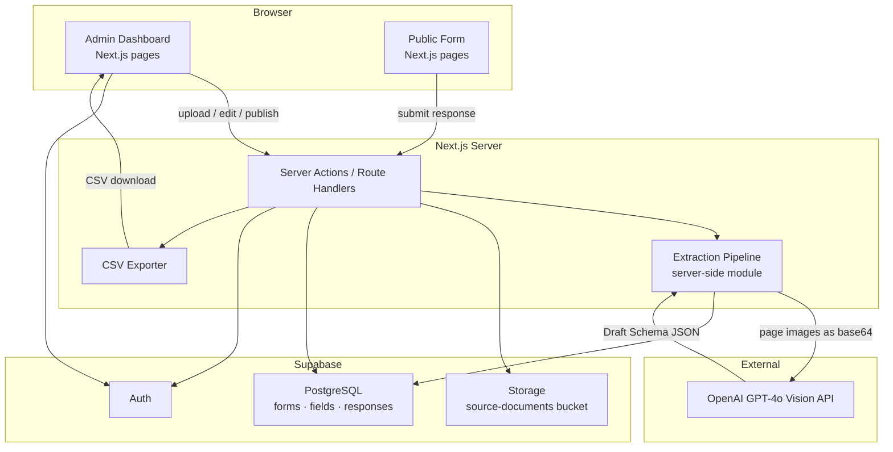

# Design Document

## Overview

Paper2Flow is a Next.js (App Router) web application that turns scanned paper forms — PDF, JPG, or
PNG — into published digital forms with shareable URLs.

The system has three main flows:

1. **Admin upload and extraction** — An authenticated administrator uploads a source document.
   A server-side pipeline converts the document to page images, calls GPT-4o Vision with a
   structured-output prompt, and stores the resulting Draft Schema in the database.
2. **Admin review and publish** — The administrator edits the draft in a form builder UI,
   resolves low-confidence fields, and publishes the form. The system assigns a unique shareable
   URL.
3. **Public form filling** — Any user with the shareable URL opens the rendered form, fills it in,
   and submits. Responses are stored in PostgreSQL and viewable as a paginated table; administrators
   can export to CSV.

The stack is **Next.js 14 App Router, TypeScript, React, Tailwind CSS, Zod, and Supabase**
(PostgreSQL + Storage + Auth).

---

## Architecture



### Key architectural decisions

| Decision | Choice | Rationale |
|---|---|---|
| AI extraction service | OpenAI GPT-4o Vision via `openai` SDK | Handles both images and PDFs (via page rendering); returns structured JSON with a single prompt; no custom training |
| PDF page rendering | `pdfjs-dist` (server bundle) | Pure JS, no native binary dependency; runs in Node.js without Ghostscript |
| Async pipeline trigger | Next.js Server Action (fire-and-update) | Keeps the upload response fast; pipeline progress is polled by the client via a lightweight status endpoint |
| Database | Supabase PostgreSQL | Matches the stated stack; RLS enforces per-admin data isolation |
| File storage | Supabase Storage (`source-documents` bucket, private) | Keeps files behind auth; signed URLs used for display |
| Auth | Supabase Auth (email/password) | Built-in session management; integrates with RLS |

---

## Components and Interfaces

### Next.js route structure

```
app/
├── (auth)/
│   └── login/                      page.tsx   – login form
├── admin/
│   ├── layout.tsx                             – auth guard wrapper
│   ├── page.tsx                               – form list / dashboard home
│   ├── upload/
│   │   └── page.tsx                           – file upload UI
│   ├── forms/
│   │   └── [formId]/
│   │       ├── review/
│   │       │   └── page.tsx                   – draft review / form builder
│   │       └── responses/
│   │           └── page.tsx                   – response viewer + CSV export
│   └── actions.ts                             – all admin server actions
├── f/
│   └── [slug]/
│       └── page.tsx                           – public published form
└── api/
    ├── forms/[formId]/status/
    │   └── route.ts                           – GET extraction status (polling)
    └── forms/[formId]/submit/
        └── route.ts                           – POST response submission
```

### Key UI components

| Component | Location | Responsibility |
|---|---|---|
| `FileUploader` | `components/admin/FileUploader.tsx` | Drag-and-drop / file picker; client-side size + format validation; upload progress bar |
| `ExtractionStatus` | `components/admin/ExtractionStatus.tsx` | Polls `/api/forms/[formId]/status`; shows spinner → redirects to review on completion |
| `FormBuilder` | `components/admin/FormBuilder.tsx` | Drag-to-reorder field list; field editor panel; undo stack; low-confidence badges |
| `FieldEditor` | `components/admin/FieldEditor.tsx` | Inline editor for label, type, placeholder, required, options (for radio/checkbox) |
| `ConfidenceBadge` | `components/admin/ConfidenceBadge.tsx` | Displays confidence score and suppress-flag button |
| `PublishButton` | `components/admin/PublishButton.tsx` | Disabled while unresolved low-confidence fields exist; shows warning dialog |
| `PublicForm` | `components/form/PublicForm.tsx` | Renders form from schema; handles Zod client-side validation; submit with retry |
| `FieldRenderer` | `components/form/FieldRenderer.tsx` | Renders each field type (text, number, date, checkbox, radio, textarea) |
| `ResponseTable` | `components/admin/ResponseTable.tsx` | Paginated table (50/page); column headers from field labels |
| `CsvExportButton` | `components/admin/CsvExportButton.tsx` | Triggers server action; streams CSV download |
| `ShareUrlDisplay` | `components/admin/ShareUrlDisplay.tsx` | Displays shareable URL with one-click copy |

### Server actions and API routes

**Server Actions (`app/admin/actions.ts`)**

```typescript
uploadDocument(formData: FormData): Promise<{ formId: string }>
saveFormSchema(formId: string, schema: FormSchema): Promise<void>
publishForm(formId: string): Promise<{ slug: string }>
unpublishForm(formId: string): Promise<void>
exportCsv(formId: string): Promise<Response>   // streams CSV
```

**API Route Handlers**

```typescript
GET  /api/forms/[formId]/status    → { status: 'pending' | 'processing' | 'ready' | 'failed', fieldCount?: number }
POST /api/forms/[formId]/submit    → stores response; returns 201 or 422 (validation error)
```

---

## Data Models

### Database schema (PostgreSQL via Supabase)

```sql
-- Administrators are Supabase Auth users; no extra users table needed.

CREATE TABLE forms (
  id            uuid PRIMARY KEY DEFAULT gen_random_uuid(),
  owner_id      uuid NOT NULL REFERENCES auth.users(id) ON DELETE CASCADE,
  title         text NOT NULL DEFAULT '',
  description   text NOT NULL DEFAULT '',
  slug          text UNIQUE,                        -- set on publish; human-readable + uuid suffix
  status        text NOT NULL DEFAULT 'draft'
                  CHECK (status IN ('draft', 'processing', 'review', 'published', 'unpublished')),
  source_path   text,                               -- Supabase Storage object path
  created_at    timestamptz NOT NULL DEFAULT now(),
  updated_at    timestamptz NOT NULL DEFAULT now()
);

CREATE TABLE fields (
  id              uuid PRIMARY KEY DEFAULT gen_random_uuid(),
  form_id         uuid NOT NULL REFERENCES forms(id) ON DELETE CASCADE,
  position        integer NOT NULL,                 -- zero-indexed display order
  label           text NOT NULL,
  field_type      text NOT NULL
                    CHECK (field_type IN ('text','number','date','checkbox','radio','textarea')),
  placeholder     text NOT NULL DEFAULT '',
  required        boolean NOT NULL DEFAULT false,
  options         jsonb,                            -- array of {label, value} for radio/checkbox
  confidence      numeric(4,3),                     -- 0.000–1.000; NULL after manual add
  confirmed       boolean NOT NULL DEFAULT false,  -- true when reviewer suppresses flag
  UNIQUE (form_id, position)
);

CREATE TABLE responses (
  id              uuid PRIMARY KEY DEFAULT gen_random_uuid(),
  form_id         uuid NOT NULL REFERENCES forms(id),
  submitted_at    timestamptz NOT NULL DEFAULT now(),
  payload         jsonb NOT NULL                    -- { [field_id]: value }
);

-- Indexes
CREATE INDEX ON forms (owner_id);
CREATE INDEX ON fields (form_id, position);
CREATE INDEX ON responses (form_id, submitted_at DESC);
```

### TypeScript types (shared)

```typescript
// types/schema.ts

export type FieldType = 'text' | 'number' | 'date' | 'checkbox' | 'radio' | 'textarea';

export interface FieldOption {
  label: string;
  value: string;
}

export interface Field {
  id: string;
  formId: string;
  position: number;
  label: string;
  fieldType: FieldType;
  placeholder: string;
  required: boolean;
  options: FieldOption[] | null;
  confidence: number | null;   // null for manually added fields
  confirmed: boolean;
}

export interface FormSchema {
  id: string;
  ownerId: string;
  title: string;
  description: string;
  slug: string | null;
  status: 'draft' | 'processing' | 'review' | 'published' | 'unpublished';
  fields: Field[];
}

export interface Response {
  id: string;
  formId: string;
  submittedAt: string;         // ISO 8601
  payload: Record<string, unknown>;
}
```

### Zod validation schemas

```typescript
// lib/validation.ts

import { z } from 'zod';

export const FieldOptionSchema = z.object({
  label: z.string().min(1),
  value: z.string().min(1),
});

export const FieldSchema = z.object({
  id: z.string().uuid(),
  position: z.number().int().nonnegative(),
  label: z.string().min(1, 'Label is required'),
  fieldType: z.enum(['text', 'number', 'date', 'checkbox', 'radio', 'textarea']),
  placeholder: z.string(),
  required: z.boolean(),
  options: z.array(FieldOptionSchema).nullable(),
  confirmed: z.boolean(),
});

export const FormSchemaZod = z.object({
  title: z.string().min(1, 'Title is required'),
  description: z.string(),
  fields: z.array(FieldSchema).min(1, 'Form must have at least one field'),
});

// Dynamically built per-form response validator (see submission handler)
export function buildResponseSchema(fields: Field[]): z.ZodObject<z.ZodRawShape> {
  const shape: z.ZodRawShape = {};
  for (const field of fields) {
    let valueSchema: z.ZodTypeAny;
    switch (field.fieldType) {
      case 'number':  valueSchema = z.number(); break;
      case 'date':    valueSchema = z.string().regex(/^\d{4}-\d{2}-\d{2}$/); break;
      case 'checkbox':valueSchema = z.array(z.string()); break;
      case 'radio':   valueSchema = z.string(); break;
      default:        valueSchema = z.string();
    }
    shape[field.id] = field.required ? valueSchema : valueSchema.optional();
  }
  return z.object(shape);
}
```

---

## AI Extraction Pipeline

### Process flow

```mermaid
sequenceDiagram
    participant SA as Server Action
    participant DB as Supabase DB
    participant ST as Supabase Storage
    participant PP as PDF/Image Processor
    participant AI as GPT-4o Vision

    SA->>ST: upload source document
    SA->>DB: INSERT forms (status='processing')
    SA-->>Browser: return formId (non-blocking)
    SA->>PP: extractFormSchema(storagePath, mimeType)
    PP->>ST: download file bytes
    PP->>PP: convert PDF pages → PNG images (pdfjs-dist)
    PP->>AI: chat.completions (images as base64 + system prompt)
    AI-->>PP: structured JSON (title, fields[], confidence scores)
    PP->>DB: INSERT fields; UPDATE forms (status='review')
    Note over DB: status='failed' if AI call throws
```

### GPT-4o Vision prompt strategy

The pipeline sends all page images in a single API call (up to the first 10 pages for MVP). The
system prompt instructs the model to output a JSON object matching the `DraftSchema` interface and
to assign a `confidence` score (0–1) per field.

```typescript
// lib/extraction/prompt.ts

export const EXTRACTION_SYSTEM_PROMPT = `
You are a form-structure extractor. Analyse the provided form images and return a single JSON
object with this exact shape:

{
  "title": string,
  "description": string,
  "sections": [{ "heading": string, "instruction": string }],
  "fields": [
    {
      "label": string,
      "fieldType": "text" | "number" | "date" | "checkbox" | "radio" | "textarea",
      "placeholder": string,
      "required": boolean,
      "options": [{ "label": string, "value": string }] | null,
      "confidence": number   // 0.0–1.0
    }
  ]
}

Rules:
- Output ONLY valid JSON. No markdown fences, no commentary.
- Assign confidence < 0.75 to any field whose type or label is uncertain.
- For checkbox and radio fields, list all visible options.
- If a field's purpose is completely illegible, include it with confidence 0.0.
`.trim();
```

The response is parsed with `JSON.parse` and validated against a Zod schema. If parsing or
validation fails, the pipeline retries once with a stricter prompt before marking the form as
`'failed'`.

### PDF page rendering

```typescript
// lib/extraction/renderPages.ts
// Uses pdfjs-dist (Node.js build) + node-canvas to rasterise each page at 150 DPI.
// Returns an array of base64-encoded PNG strings.
export async function renderPdfPages(pdfBytes: Uint8Array): Promise<string[]>
```

For JPG/PNG uploads, the image is passed directly (no rendering step).

### Confidence scoring

Fields with `confidence < 0.75` are "Low-Confidence Fields" per the glossary. The pipeline stores
the raw `confidence` value from the model. The `0.75` threshold is a named constant
(`LOW_CONFIDENCE_THRESHOLD = 0.75`) in `lib/constants.ts` so it can be adjusted without touching
multiple files.

---

## Supabase Integration

### Auth

- Supabase Auth handles session cookies via the `@supabase/ssr` package (server-side client).
- The admin layout (`app/admin/layout.tsx`) calls `supabase.auth.getSession()` server-side; if
  no session exists it redirects to `/login`.
- The public form route (`app/f/[slug]/page.tsx`) requires no auth.

### Storage

- Bucket: `source-documents` (private, 20 MB max enforced by Storage policy).
- Files are stored at `{owner_id}/{formId}/original.{ext}`.
- The pipeline downloads files using the service-role key (server-only); the browser never touches
  the bucket directly.

### RLS policies

```sql
-- forms: owner can read/write their own rows
ALTER TABLE forms ENABLE ROW LEVEL SECURITY;
CREATE POLICY "owner_all" ON forms
  USING (auth.uid() = owner_id)
  WITH CHECK (auth.uid() = owner_id);

-- fields: derived from form ownership
ALTER TABLE fields ENABLE ROW LEVEL SECURITY;
CREATE POLICY "owner_all" ON fields
  USING (
    EXISTS (SELECT 1 FROM forms WHERE forms.id = fields.form_id AND forms.owner_id = auth.uid())
  )
  WITH CHECK (
    EXISTS (SELECT 1 FROM forms WHERE forms.id = fields.form_id AND forms.owner_id = auth.uid())
  );

-- responses: owner can read; anyone can insert into published forms
ALTER TABLE responses ENABLE ROW LEVEL SECURITY;
CREATE POLICY "owner_read" ON responses
  FOR SELECT USING (
    EXISTS (SELECT 1 FROM forms WHERE forms.id = responses.form_id AND forms.owner_id = auth.uid())
  );
CREATE POLICY "public_insert" ON responses
  FOR INSERT WITH CHECK (
    EXISTS (SELECT 1 FROM forms WHERE forms.id = responses.form_id AND forms.status = 'published')
  );
```

The API route handler for form submission uses the **anon** Supabase client, so the `public_insert`
RLS policy (not the service role) governs inserts. This prevents inserting into unpublished forms
without any application-level check.

---

## CSV Export Implementation

The export is a Next.js Server Action that streams a CSV response.

```
Algorithm:
1. Verify the requesting user owns the form (server-side auth check).
2. Fetch all fields (ordered by position) for the form.
3. Fetch all responses (ordered by submitted_at ASC) for the form.
4. Build header row: ["Submitted At", ...field.label for each field]
5. For each response, build a data row:
   - Column 0: response.submitted_at (ISO 8601)
   - Columns 1-N: response.payload[field.id] ?? ''
   - Date field values are formatted as YYYY-MM-DD.
6. Escape each cell: wrap in double quotes; double any internal double quotes.
7. Join rows with CRLF; encode as UTF-8 with BOM (0xEF 0xBB 0xBF) for Excel compatibility.
8. Return as a streaming Response with Content-Disposition: attachment; filename="responses.csv".
```

---

## Error Handling

| Scenario | Handling |
|---|---|
| File > 20 MB selected | Client-side check before upload; `FileUploader` shows inline error |
| Unsupported file format | Client-side MIME check; inline error message |
| Storage upload failure | Server Action returns `{ error }` to client; file input is not cleared |
| Extraction pipeline failure | `forms.status` → `'failed'`; polling endpoint returns `'failed'`; UI offers re-upload |
| GPT-4o JSON parse error | One retry with stricter prompt; then mark failed |
| GPT-4o API timeout / rate limit | Caught in pipeline; mark failed; error message stored in `forms.error_message` text column |
| Form submission to unpublished form | RLS `public_insert` policy blocks the INSERT at DB level; API returns 404 |
| Response payload fails Zod validation | API returns 422 with field-level error array; client displays inline messages |
| Network error on submit | Client catches fetch failure; shows retry message; retains form data |
| Publish with unresolved low-confidence fields | `PublishButton` checks count; shows blocking warning dialog |
| CSV export with zero responses | Server Action returns 400; `CsvExportButton` is disabled (count = 0) |
| Concurrent submissions | PostgreSQL handles concurrency; `responses.id` uniqueness prevents duplicates |

---

## Testing Strategy

This feature is primarily CRUD, UI rendering, and AI-integration work. The business logic layers
suitable for automated unit testing are the validation utilities, the CSV formatter, and the
extraction pipeline schema parser. UI components are tested with snapshot and interaction tests.

### Unit tests

- `lib/validation.ts` — `buildResponseSchema`: test that required fields reject empty values, that
  optional fields accept them, that number fields reject strings, that date fields enforce
  `YYYY-MM-DD`.
- `lib/extraction/prompt.ts` — test that the parsed GPT-4o response (fixture JSON) maps correctly
  to `Field[]` with the right confidence values.
- `lib/csv.ts` — test header row construction, date formatting, cell escaping (cells containing
  commas, quotes, newlines), UTF-8 BOM presence.
- `lib/constants.ts` — `LOW_CONFIDENCE_THRESHOLD` is `0.75`.

### Integration tests

- Upload flow: mock Supabase Storage and OpenAI; verify `forms.status` transitions
  (`processing` → `review`).
- Submission handler: POST a valid payload to `/api/forms/[formId]/submit`; assert 201 and row in
  `responses`.
- Submission handler: POST an invalid payload; assert 422 and no row inserted.

### Component tests (React Testing Library)

- `FileUploader`: selecting an oversized file shows the error message.
- `FormBuilder`: dragging a field to a new position updates the `position` values.
- `PublicForm`: submitting with an empty required field shows the validation message.
- `ResponseTable`: renders paginated rows; next/previous controls change the visible page.

Property-based testing is not applied to this feature because the dominant logic paths are
UI rendering, CRUD database operations, and external AI integration — none of which benefit from
randomised input generation over targeted example-based tests. The one structural-logic candidate
(response schema construction) is better covered by a small set of explicit examples that document
the intended behaviour per field type.
